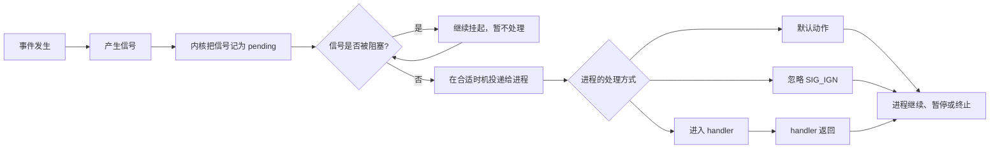

# 2. 信号：Linux 进程的“异步通知”和“软件中断”

> 本章的目标不是背下 64 个信号，而是建立一个可以反复使用的思维模型：
>
> **谁产生了信号？发给谁？信号现在在哪里？进程什么时候处理？处理方式是什么？**

你已经接触过 STM32 的中断、回调函数、串口接收和状态机。Linux 信号可以先这样理解：

| STM32 中的概念    | Linux 信号中的对应概念   |
| ------------- | ---------------- |
| 外部引脚变化、定时器溢出  | 键盘输入、定时器到期、子进程退出 |
| NVIC/硬件产生中断请求 | 内核记录一个待处理信号      |
| 中断服务函数 ISR    | 信号处理函数 handler   |
| 清除中断标志位       | 返回处理函数后，信号状态被更新  |
| 主循环继续运行       | 进程继续执行原来的代码      |

这个类比很有用，但不要把它们完全等同：**硬件中断进入的是内核或 CPU 的中断机制，信号最终执行的是目标进程自己的用户态处理函数。**

## 2.1. 先看全局：一个信号到底是什么

### 2.1.1. 一句话定义

信号（signal）是 Linux 内核提供给进程的一种**异步事件通知机制**。

它通常只携带一个信号编号，例如 `SIGINT` 是 2，意思是“收到中断请求”；它不像管道、消息队列那样主要传递一段数据，而是告诉进程：

> “某件事情发生了，请按照你预先设置的规则处理。”

信号的产生者可以是：

- 内核：例如进程访问非法内存，内核发送 `SIGSEGV`；
- 终端：按下 `Ctrl+C`，终端驱动向前台进程组发送 `SIGINT`；
- 另一个进程：通过 `kill()` 或 `sigqueue()` 发送；
- 进程自己：通过 `raise()` 发送给自己；
- 定时器：`alarm()` 到期后发送 `SIGALRM`。

### 2.1.2. 信号处理的完整链路

可以把信号的生命周期记成下面这条链：



这里有四个容易混淆的词：

- **产生（generate）**：事件导致信号被创建，例如按下 `Ctrl+C`；
- **挂起（pending）**：信号已经产生，但还没有真正执行处理；
- **阻塞（block）**：进程暂时不允许某个信号被投递；
- **捕获（catch）**：进程为信号注册了自己的处理函数。

注意：阻塞不是忽略。阻塞只是“先放到待处理区”；解除阻塞后，如果信号仍然 pending，内核仍可能投递它。

### 2.1.3. 默认动作、忽略和捕获

当信号可以被投递时，进程有三种处理方式：

1. **默认处理（`SIG_DFL`）**：由内核按照该信号规定的默认动作处理；
2. **忽略（`SIG_IGN`）**：收到后直接丢弃；
3. **捕获（handler）**：进入程序提前注册的函数。

常见默认动作包括：

- 终止进程；
- 终止进程并生成 core 转储；
- 忽略信号；
- 暂停进程；
- 让暂停的进程继续运行。

有两个例外必须记住：

> `SIGKILL` 和 `SIGSTOP` 不能被捕获、阻塞或忽略。

这是为了保证系统始终有办法强制终止或暂停一个失控进程。

### 2.1.4. 常用信号速查表

信号编号在不同平台上可能不同。程序中应优先使用 `SIGINT`、`SIGTERM` 这样的宏，而不要把数字直接写死。

| 信号 | 常见来源 | 默认动作 | 记忆方式 |
| --- | --- | --- | --- |
| `SIGHUP` | 终端关闭、会话断开 | 终止 | Hang up，挂断 |
| `SIGINT` | `Ctrl+C` | 终止 | Interrupt，中断 |
| `SIGQUIT` | `Ctrl+\\` | 终止并生成 core | Quit，退出并留下现场 |
| `SIGILL` | 执行非法指令 | 终止并生成 core | Illegal instruction |
| `SIGTRAP` | 断点、调试陷阱 | 终止并生成 core | 调试器常用 |
| `SIGABRT` | `abort()` | 终止并生成 core | Abort，主动中止 |
| `SIGBUS` | 总线错误、地址对齐问题 | 终止并生成 core | 总线访问异常 |
| `SIGFPE` | 除零、算术异常 | 终止并生成 core | Floating-point exception |
| `SIGKILL` | `kill -9` | 立即终止 | 不能捕获 |
| `SIGUSR1` | 用户自定义 | 终止 | 给应用自己约定 |
| `SIGSEGV` | 非法内存访问 | 终止并生成 core | 段错误 |
| `SIGUSR2` | 用户自定义 | 终止 | 给应用自己约定 |
| `SIGPIPE` | 向已关闭的管道或 socket 写入 | 终止 | 对端没了还在写 |
| `SIGALRM` | `alarm()` 到期 | 终止 | 闹钟 |
| `SIGTERM` | `kill PID` 默认发送 | 终止 | 请求程序正常退出 |
| `SIGCHLD` | 子进程停止或退出 | 忽略 | 父进程的“孩子有变化”通知 |
| `SIGCONT` | 继续一个暂停进程 | 继续运行 | Continue |
| `SIGSTOP` | `kill -STOP`、`raise()` | 暂停 | 不能捕获 |
| `SIGTSTP` | `Ctrl+Z` | 暂停 | 可以捕获的终端暂停 |
| `SIGWINCH` | 终端窗口大小变化 | 忽略 | Window changed |

查看当前系统支持的信号：

```bash
kill -l
```

不同架构、不同 C 库实现的编号可能存在差异；实时信号也应通过 `SIGRTMIN` 和 `SIGRTMAX` 获取边界，不要依赖某个固定数字。

### 2.1.5. 标准信号和实时信号

Linux 信号大致可以分为两类：

- **标准信号**：通常是 `1~31` 范围内的传统信号；
- **实时信号**：通常由 `SIGRTMIN` 到 `SIGRTMAX` 表示。

两者最关键的区别是：**是否排队，以及是否能携带用户数据。**

假设程序还没有来得及处理 `SIGUSR1`，此时连续发送 5 次标准信号：

```text
发送：SIGUSR1 SIGUSR1 SIGUSR1 SIGUSR1 SIGUSR1
结果：       一个 SIGUSR1 处于 pending 状态
```

标准信号通常只记录“这个信号来了”，相同信号不会按 5 个排队，因此可能合并。

实时信号则支持排队：

```text
发送：实时信号 A、实时信号 B、实时信号 C
结果：A、B、C 依次等待处理，并且可以携带 sigval 数据
```

这就是传统信号被称为“不可靠信号”、实时信号被称为“可靠信号”的主要原因。这里的“不可靠”不是说内核随机丢信号，而是说**同类标准信号在未处理期间可能合并，无法保证一发一收。**

如果业务要求“每一条事件都不能丢”，信号通常不是首选，应考虑管道、消息队列、eventfd、socket 或其他 IPC；如果确实要使用信号，可以研究 `sigqueue()` 和实时信号。

## 2.2. 信号什么时候到达：同步和异步

### 2.2.1. 同步信号

同步信号和当前执行指令直接相关，通常是进程自己“跑出问题”导致的：

- 除数为 0，产生 `SIGFPE`；
- 访问非法内存，产生 `SIGSEGV`；
- 执行非法指令，产生 `SIGILL`；
- 调用 `raise()` 给自己发送信号。

它们通常发生在某条指令或某个明确的操作附近，所以相对容易定位。

### 2.2.2. 异步信号

异步信号来自当前进程不可预测的外部事件：

- 用户按下 `Ctrl+C`；
- 另一个进程调用 `kill()`；
- 定时器到期；
- 子进程退出。

进程无法知道它具体什么时候到达，只能提前告诉内核：

> “如果这个信号来了，请按这个规则处理。”

这和 STM32 主循环中等待外部中断的感觉很像：主循环不知道按键会在哪一时刻触发，但可以提前注册中断服务逻辑。

### 2.2.3. 信号不是普通函数调用

程序看起来可能是这样：

```c
while (1) {
    do_work();
}
```

某个时刻信号到达后，执行过程更接近：

```text
do_work() 执行到一半
        ↓
内核发现有可投递信号
        ↓
临时切换到 handler(sig)
        ↓
handler 返回
        ↓
回到 do_work() 后面继续执行，或系统调用被中断
```

因此信号处理函数可能在主程序的任意位置打断执行。它不是普通的“主线程主动调用回调”，这也是信号编程容易出错的根源。

## 2.3. 信号处理函数：先学会安全地“收到通知”

### 2.3.1. 信号处理函数中能做什么

信号处理函数应尽量短小。最稳妥的模式是：

1. handler 只修改一个 `volatile sig_atomic_t` 标志；
2. 主循环检测标志；
3. 主循环负责打印、释放资源、关闭文件、退出线程等复杂工作。

```c
#include <signal.h>
#include <stdio.h>
#include <unistd.h>

static volatile sig_atomic_t stop = 0;

static void on_sigint(int sig)
{
    (void)sig;
    stop = 1;
}

int main(void)
{
    struct sigaction act = {0};
    act.sa_handler = on_sigint;
    sigemptyset(&act.sa_mask);

    if (sigaction(SIGINT, &act, NULL) == -1) {
        perror("sigaction");
        return 1;
    }

    while (!stop) {
        puts("运行中，按 Ctrl+C 请求退出...");
        sleep(1);
    }

    puts("主循环发现退出标志，开始清理资源。");
    return 0;
}
```

这里最重要的不是语法，而是执行关系：

```text
Ctrl+C
  ↓
SIGINT 到达
  ↓
on_sigint() 只设置 stop = 1
  ↓
主循环重新获得执行权
  ↓
主循环发现 stop，执行安全的退出流程
```

### 2.3.2. 为什么 handler 里不建议直接 `printf()`

很多入门示例会在 handler 中调用 `printf()`，这样现象直观，但工程代码不建议这样写。

原因是：`printf()` 内部可能使用缓冲区和锁。如果信号恰好在主程序已经持有该锁时到达，handler 再次调用 `printf()` 可能造成死锁或数据损坏。

信号处理函数中应优先使用异步信号安全函数，例如 `write()`；但即使是安全函数，也要尽量缩短处理时间。下面的代码只用于演示安全输出：

```c
#include <signal.h>
#include <unistd.h>

static void on_sigint(int sig)
{
    static const char message[] = "收到 SIGINT\n";
    (void)sig;
    write(STDOUT_FILENO, message, sizeof(message) - 1);
}
```

实际项目中，推荐使用前面的“handler 设标志，主循环做工作”模式。

## 2.4. `signal()`：简单，但主要用于阅读旧代码

### 2.4.1. 函数原型

```c
#include <signal.h>

typedef void (*sighandler_t)(int);

sighandler_t signal(int signum, sighandler_t handler);
```

可以把它拆成一句人话：

```text
signal(要处理的信号编号, 收到信号后调用的函数)
```

例如：

```c
signal(SIGINT, on_sigint);  // Ctrl+C 时调用 on_sigint
signal(SIGPIPE, SIG_IGN);   // 忽略 SIGPIPE
signal(SIGINT, SIG_DFL);    // 恢复 SIGINT 的默认动作
```

`handler` 有三种常见形式：

- 自定义函数，例如 `on_sigint`；
- `SIG_IGN`：忽略；
- `SIG_DFL`：恢复默认动作。

`signal()` 的返回值是旧的处理函数指针；失败时返回 `SIG_ERR`，并设置 `errno`。

### 2.4.2. `signal()` 实验：第一次捕获，第二次恢复默认

下面的代码保留了你原文中的实验意图：第一次按 `Ctrl+C` 时进入 handler，并在 handler 中把信号恢复为默认处理；第二次再按时，进程终止。

```c
#include <signal.h>
#include <stdio.h>
#include <unistd.h>

static void signal_handler(int sig)
{
    const char message[] = "第一次收到 SIGINT，恢复默认处理\n";

    (void)sig;
    write(STDOUT_FILENO, message, sizeof(message) - 1);
    signal(SIGINT, SIG_DFL);
}

int main(void)
{
    signal(SIGINT, signal_handler);

    while (1) {
        puts("waiting for SIGINT, please press Ctrl+C...");
        sleep(1);
    }
}
```

实验过程：

```text
程序启动
  ↓
SIGINT 的处理方式 = signal_handler
  ↓
第一次 Ctrl+C
  ↓
执行 signal_handler
  ↓
SIGINT 的处理方式 = SIG_DFL
  ↓
第二次 Ctrl+C
  ↓
执行默认动作：终止进程
```

> 学习重点：`signal()` 改变的是“这个信号以后怎么处理”，不是只影响当前一次事件。

不过，在不同系统和 C 库上，传统 `signal()` 的语义可能存在差异，例如 handler 是否自动恢复、系统调用是否自动重启等。因此新代码优先使用 `sigaction()`。

## 2.5. `sigaction()`：工程代码更推荐的接口

### 2.5.1. 函数原型和结构体

```c
#include <signal.h>

int sigaction(int signum,
              const struct sigaction *act,
              struct sigaction *oldact);
```

常用成员可以这样理解：

```c
struct sigaction {
    void     (*sa_handler)(int);
    void     (*sa_sigaction)(int, siginfo_t *, void *);
    sigset_t   sa_mask;
    int        sa_flags;
    void     (*sa_restorer)(void);
};
```

- `sa_handler`：普通 handler，只接收信号编号；
- `sa_sigaction`：扩展 handler，可以获得发送者 PID、发送方式、附带数据等信息；
- `sa_mask`：handler 执行期间临时阻塞哪些信号；
- `sa_flags`：修改信号处理行为；
- `oldact`：保存旧配置，不需要时传 `NULL`。

`sa_handler` 和 `sa_sigaction` 是联合关系，二选一使用。使用 `sa_sigaction` 时必须设置 `SA_SIGINFO`。

### 2.5.2. 最小可用模板

```c
#include <signal.h>
#include <stdio.h>
#include <unistd.h>

static volatile sig_atomic_t stop = 0;

static void on_sigint(int sig)
{
    (void)sig;
    stop = 1;
}

int main(void)
{
    struct sigaction act = {0};

    act.sa_handler = on_sigint;
    sigemptyset(&act.sa_mask);
    act.sa_flags = 0;

    if (sigaction(SIGINT, &act, NULL) == -1) {
        perror("sigaction");
        return 1;
    }

    while (!stop) {
        puts("等待 SIGINT...");
        sleep(1);
    }

    puts("收到退出请求，安全退出。");
    return 0;
}
```

每次使用 `sigaction()` 都可以按这四步检查：

1. `struct sigaction act = {0};`：先初始化结构体，避免成员含有随机值；
2. 填 `sa_handler` 或 `sa_sigaction`；
3. 调用 `sigemptyset(&act.sa_mask)`；
4. 设置需要的 `sa_flags`，再调用 `sigaction()`。

### 2.5.3. 常用 `sa_flags`

| 标志 | 作用 | 学习阶段的理解 |
| --- | --- | --- |
| `SA_RESETHAND` | 投递信号时将处理方式恢复为默认 | 一次性 handler |
| `SA_SIGINFO` | 使用三参数的 `sa_sigaction` | 获取发送者和附加信息 |
| `SA_NOCLDSTOP` | `SIGCHLD` 不报告子进程暂停/继续 | 只关心子进程退出 |
| `SA_NOCLDWAIT` | 子进程退出后不保留僵尸状态 | 不需要手动回收时使用，需谨慎 |
| `SA_NODEFER` | handler 执行时不自动阻塞同一个信号 | 允许重入，通常不要随便使用 |
| `SA_RESTART` | 尽可能自动重启被信号打断的系统调用 | 减少 `EINTR`，但不是所有调用都重启 |

特别注意 `SA_RESETHAND`：它不是“handler 返回后才恢复”，而是在这次信号投递时就把处理方式改回默认。因此它适合做“一次性捕获”实验，不适合作为常规退出模板。

### 2.5.4. 用 `SA_SIGINFO` 查看是谁发送的信号

如果信号由另一个进程发送，普通 handler 只知道“来了哪个信号”，而扩展 handler 可以看到更多信息：

```c
#include <signal.h>
#include <stdio.h>
#include <unistd.h>

static void on_usr1(int sig, siginfo_t *info, void *context)
{
    (void)context;
    printf("收到信号 %d，发送者 PID = %d\n", sig, info->si_pid);
}

int main(void)
{
    struct sigaction act = {0};

    act.sa_sigaction = on_usr1;
    sigemptyset(&act.sa_mask);
    act.sa_flags = SA_SIGINFO;

    if (sigaction(SIGUSR1, &act, NULL) == -1) {
        perror("sigaction");
        return 1;
    }

    printf("当前 PID = %d，请在另一个终端执行：kill -USR1 %d\n",
           getpid(), getpid());

    while (1) {
        pause();
    }
}
```

`siginfo_t` 中常见的成员包括：

- `si_signo`：信号编号；
- `si_pid`：发送信号的进程 PID；
- `si_uid`：发送者的真实用户 ID；
- `si_code`：信号产生原因；
- `si_value`：通过 `sigqueue()` 携带的用户数据；
- `si_addr`：发生内存访问错误时的故障地址。

不要一开始就背完整的 `siginfo_t` 结构体。先记住：**需要知道“是谁发的、为什么发、带了什么数据”时，才使用 `SA_SIGINFO`。**

## 2.6. 信号屏蔽：不是删除，而是暂缓处理

每个线程都有自己的信号屏蔽字（signal mask）。被屏蔽的信号仍可能产生，但不会立即进入 handler。

```c
sigset_t set;

sigemptyset(&set);
sigaddset(&set, SIGINT);
sigprocmask(SIG_BLOCK, &set, NULL);    // 暂时阻塞 SIGINT

/* 这里按 Ctrl+C，SIGINT 会处于 pending 状态 */

sigprocmask(SIG_UNBLOCK, &set, NULL);  // 解除阻塞，之后可能立即进入 handler
```

可以用下面的关系检查自己的理解：

```text
信号产生  ≠  信号立即执行

产生后：
    被阻塞  → pending，等待解除阻塞
    未阻塞  → 在合适时机投递，执行默认动作或 handler
```

在多线程程序中，进程级信号和线程级信号还需要进一步区分：普通 `kill()` 通常面向进程，`pthread_kill()` 面向指定线程；信号屏蔽字则是每个线程独立维护的。

## 2.7. 发送信号：`kill()`、`raise()` 和命令行 `kill`

### 2.7.1. 命令行 `kill`

命令行的 `kill` 并不等于“杀死”，它的本质是**向目标进程发送指定信号**。

```bash
kill PID             # 默认发送 SIGTERM
kill -TERM PID      # 明确发送 SIGTERM
kill -9 PID         # 发送 SIGKILL，强制终止
kill -USR1 PID      # 发送用户自定义信号
```

推荐优先使用 `SIGTERM`：它给程序一个自己清理资源、保存状态、关闭设备的机会。只有程序失控或无法响应时，才考虑 `SIGKILL`。

### 2.7.2. `kill()` 函数

```c
#include <sys/types.h>
#include <signal.h>

int kill(pid_t pid, int sig);
```

`pid` 的含义：

| `pid` | 目标 |
| --- | --- |
| `pid > 0` | PID 等于 `pid` 的进程 |
| `pid == 0` | 当前进程所在进程组中的所有进程 |
| `pid < -1` | 进程组 ID 为 `-pid` 的所有进程 |
| `pid == -1` | 当前用户有权限发送信号的多个进程，具体排除规则以系统手册为准 |

返回值为 0 表示发送请求成功，返回 -1 表示失败，并设置 `errno`。常见错误：

- `ESRCH`：目标进程不存在；
- `EPERM`：没有权限；
- `EINVAL`：信号编号无效。

还有一个很实用的检查技巧：

```c
kill(pid, 0);
```

信号编号为 0 不会真正发送信号，但可以用来检查目标进程是否存在，以及当前进程是否有权限操作它。

### 2.7.3. `raise()` 函数

```c
#include <signal.h>

int raise(int sig);
```

`raise(sig)` 用于向当前执行单元发送信号。单线程程序中，可以把它粗略理解为：

```c
kill(getpid(), sig);
```

例如：

```c
raise(SIGSTOP);  // 暂停自己
raise(SIGTERM);  // 请求终止自己
```

在多线程程序中，`raise()` 的目标是调用它的线程，因此不要简单把它理解成“发给整个进程”。

## 2.8. 父子进程实验：`SIGSTOP`、`SIGKILL` 和 `waitpid()`

这个实验把几个知识点串起来：

```text
父进程 fork()
      ├── 子进程：打印 PID，raise(SIGSTOP)，暂停
      └── 父进程：等待子进程暂停，kill(SIGKILL)，回收子进程
```

完整示例：

```c
#include <errno.h>
#include <signal.h>
#include <stdio.h>
#include <stdlib.h>
#include <sys/wait.h>
#include <unistd.h>

int main(void)
{
    pid_t pid = fork();

    if (pid < 0) {
        perror("fork");
        return 1;
    }

    if (pid == 0) {
        printf("子进程 PID = %d，准备暂停\n", getpid());
        raise(SIGSTOP);
        printf("这句话不会在 SIGSTOP 后立即执行\n");
        _exit(0);
    }

    int status = 0;
    pid_t result = waitpid(pid, &status, WUNTRACED);

    if (result == -1) {
        perror("waitpid");
        return 1;
    }

    if (WIFSTOPPED(status)) {
        printf("父进程观察到子进程已暂停，发送 SIGKILL\n");
        if (kill(pid, SIGKILL) == -1) {
            perror("kill");
            return 1;
        }
    }

    if (waitpid(pid, &status, 0) == -1) {
        perror("waitpid");
        return 1;
    }

    if (WIFSIGNALED(status)) {
        printf("子进程被信号 %d 终止\n", WTERMSIG(status));
    }

    return 0;
}
```

这里有三个关键点：

1. `SIGSTOP` 不能被捕获，所以子进程会确实暂停；
2. `SIGKILL` 不能被捕获，所以子进程不能拒绝被强制终止；
3. `waitpid()` 不只是“等一等”，还负责读取子进程状态并回收资源。

原文中的 `waitpid(pid, NULL, WNOHANG)` 适合演示“非阻塞查询”：返回 0 表示当前没有可报告的状态，返回子 PID 表示有状态可读取。它本身并不会“收集子进程发出的信号”；子进程的暂停、退出状态需要通过 `status` 和 `WIFSTOPPED()`、`WIFEXITED()`、`WIFSIGNALED()` 等宏判断。

## 2.9. `SIGCHLD` 和僵尸进程

子进程退出后，内核还要保留它的退出码、终止信号等信息，方便父进程查询。父进程没有调用 `wait()` 或 `waitpid()` 回收之前，子进程可能处于僵尸状态（`Z`）。

```text
子进程运行
    ↓ exit()
子进程已经结束，但退出信息暂存于内核
    ↓ 父进程 wait()/waitpid()
退出信息被读取，内核释放子进程的进程表项
```

`SIGCHLD` 只是“子进程状态发生变化”的通知，不等于资源已经回收。典型处理方式如下：

```c
static void on_sigchld(int sig)
{
    (void)sig;
    /* 工程代码通常只设置标志，或在安全场景中循环 waitpid */
}
```

主循环中再调用：

```c
int status;
while (waitpid(-1, &status, WNOHANG) > 0) {
    /* 回收所有已经退出的子进程 */
}
```

如果父进程完全不需要知道子进程的退出状态，可以研究 `SA_NOCLDWAIT` 或将 `SIGCHLD` 设置为 `SIG_IGN`，但不要为了“看起来方便”就直接这么做。先明确业务是否需要获取退出码。

## 2.10. `alarm()`：进程的一次性闹钟

### 2.10.1. 函数原型

```c
#include <unistd.h>

unsigned int alarm(unsigned int seconds);
```

调用 `alarm(seconds)` 后，经过大约 `seconds` 秒，内核向当前进程发送 `SIGALRM`。

它有三个重要特点：

1. 一个进程通常只有一个由 `alarm()` 设置的闹钟；
2. 再次调用会覆盖前一次设置；
3. `alarm(0)` 会取消当前闹钟。

返回值是旧闹钟的剩余秒数；如果之前没有闹钟，返回 0。时间是近似值，进程调度、系统负载和信号处理都会影响实际执行时刻。

### 2.10.2. 默认处理实验

```c
#include <stdio.h>
#include <unistd.h>

int main(void)
{
    puts("5 秒后会收到 SIGALRM...");
    alarm(5);
    sleep(20);
    puts("如果没有捕获 SIGALRM，通常不会执行到这里。");
    return 0;
}
```

因为没有为 `SIGALRM` 注册 handler，系统会执行它的默认动作，通常终止进程。因此最后一行可能不会打印。

### 2.10.3. 捕获 `SIGALRM`

```c
#include <signal.h>
#include <stdio.h>
#include <unistd.h>

static volatile sig_atomic_t timeout = 0;

static void on_alarm(int sig)
{
    (void)sig;
    timeout = 1;
}

int main(void)
{
    struct sigaction act = {0};
    act.sa_handler = on_alarm;
    sigemptyset(&act.sa_mask);

    if (sigaction(SIGALRM, &act, NULL) == -1) {
        perror("sigaction");
        return 1;
    }

    alarm(5);

    while (!timeout) {
        puts("等待超时...");
        sleep(1);
    }

    puts("超时标志已被主循环发现。");
    return 0;
}
```

### 2.10.4. 覆盖前一个闹钟

```c
#include <stdio.h>
#include <unistd.h>

int main(void)
{
    unsigned int remaining;

    remaining = alarm(20);
    printf("旧闹钟剩余：%u 秒\n", remaining);

    sleep(5);

    remaining = alarm(5);
    printf("覆盖前旧闹钟大约剩余：%u 秒\n", remaining);

    sleep(20);
    puts("如果没有捕获 SIGALRM，进程会在新闹钟到期时终止。");
    return 0;
}
```

执行逻辑是：先设置 20 秒，睡眠 5 秒；再设置 5 秒，前一个闹钟被覆盖。此时从第二次 `alarm()` 返回的剩余时间通常接近 15 秒，但由于时间取整和调度，不能把它当成精确测量值。

## 2.11. 编译和实验路线

如果使用配套实验目录，可以按照下面的顺序操作。每次实验都先预测现象，再运行验证：

```bash
# 在对应实验目录编译 x86 版本
make

# 运行示例
./build_x86/signal_demo
```

如果要交叉编译到开发板：

```bash
make ARCH=ARM
```

建议按这个顺序学习：

### 实验一：默认动作

程序循环打印，按 `Ctrl+C`。先不要看代码细节，只回答：

```text
谁产生信号？       终端
产生什么信号？     SIGINT
发给谁？           前台进程组
谁执行默认动作？   Linux 内核按进程配置处理
结果是什么？       进程终止
```

### 实验二：捕获 `SIGINT`

注册 handler 后再次按 `Ctrl+C`，观察进程为什么没有立刻退出。然后在 handler 中恢复 `SIG_DFL`，再按一次观察第二次行为。

### 实验三：用 `kill` 发 `SIGUSR1`

终端一运行程序并记录 PID，终端二发送：

```bash
kill -USR1 PID
```

重点观察：信号不一定来自键盘，也可以由另一个进程主动发送。

### 实验四：父子进程和 `SIGCHLD`

使用 `fork()` 创建子进程，让子进程退出；父进程用 `waitpid()` 回收。再故意暂时不回收，用 `ps` 观察 `Z` 状态，理解僵尸进程的来源。

### 实验五：`alarm()` 超时

先观察默认动作，再添加 handler。最后修改闹钟时间，确认第二次 `alarm()` 会覆盖第一次。

## 2.12. 信号编程的几个高频坑

### 坑 1：把信号当成可靠消息队列

标准信号可能合并。不要用连续发送多个 `SIGUSR1` 来表示“有 5 个任务等待处理”。需要计数和携带数据时，改用实时信号、管道、消息队列或其他 IPC。

### 坑 2：在 handler 中做复杂工作

不要在 handler 中进行复杂日志、内存分配、加锁、访问非线程安全库。推荐只设置 `sig_atomic_t` 标志。

### 坑 3：以为 `SIGTERM` 和 `SIGKILL` 一样

`SIGTERM` 是“请求程序终止”，可以捕获和清理；`SIGKILL` 是“立即强制终止”，无法捕获和清理。

### 坑 4：以为 `SIGCHLD` 自动回收子进程

`SIGCHLD` 只是通知。父进程仍需 `wait()` 或 `waitpid()`，否则可能产生僵尸进程。

### 坑 5：忽略系统调用被信号打断

信号可能让 `read()`、`sleep()`、`accept()` 等调用提前返回，并设置 `errno = EINTR`。是否自动重启取决于系统调用和 `sigaction()` 的标志，不能一概而论。

典型处理方式：

```c
ssize_t n;
do {
    n = read(fd, buffer, sizeof(buffer));
} while (n == -1 && errno == EINTR);
```

### 坑 6：在多线程程序中只看“进程”

信号屏蔽字是线程独立的；普通信号可能投递给进程中某个未屏蔽它的线程。涉及线程时，要一起考虑 `pthread_sigmask()`、`pthread_kill()` 和专门的信号处理线程。

## 2.13. 用一张表复习全部 API

| API | 作用 | 典型使用场景 | 关键注意点 |
| --- | --- | --- | --- |
| `signal()` | 简单注册处理方式 | 阅读旧代码、快速实验 | 语义可移植性较差 |
| `sigaction()` | 可靠地配置处理方式 | 新项目、工程代码 | 先初始化结构体和信号集 |
| `kill()` | 给进程或进程组发信号 | 进程控制、进程间通知 | 需要权限，检查返回值 |
| `raise()` | 给自己发送信号 | 自测、主动触发处理逻辑 | 多线程时注意目标是当前线程 |
| `alarm()` | 设置一次性 `SIGALRM` | 简单超时实验 | 只有一个闹钟，会覆盖 |
| `pause()` | 睡眠直到收到信号 | 等待信号的简单程序 | 返回后要重新判断条件 |
| `waitpid()` | 等待并回收子进程 | 处理 `SIGCHLD`、防止僵尸 | 用 status 宏判断状态 |

## 2.14. 最后形成自己的“信号五问”

以后遇到任何信号问题，都按这五个问题排查：

1. **谁产生的？** 内核、终端、定时器，还是另一个进程？
2. **发给谁？** 某个 PID、进程组、当前进程，还是当前线程？
3. **现在什么状态？** 已投递、被阻塞、还是处于 pending？
4. **配置的动作是什么？** 默认、忽略，还是 handler？
5. **handler 是否安全？** 是否调用了不安全的库函数，是否可能被重入，是否影响了系统调用？

可以把整章压缩成一句话：

> **信号是内核给进程按门铃；`signal()`/`sigaction()`决定谁接电话，`kill()`/`raise()`负责按铃，`alarm()`负责定时按铃，而 `waitpid()`负责处理子进程退出后的收尾。**

相关实验资料中的原图仍可作为现象对照：

- [信号列表示例](https://doc.embedfire.com/linux/imx6/linux_base/zh/latest/_images/signal002.png)
- [默认 `SIGINT` 示例](https://doc.embedfire.com/linux/imx6/linux_base/zh/latest/_images/signal003.png)
- [`signal()` 捕获示例](https://doc.embedfire.com/linux/imx6/linux_base/zh/latest/_images/signal007.png)
- [`sigaction()` 示例](https://doc.embedfire.com/linux/imx6/linux_base/zh/latest/_images/signal008.png)
- [`kill()`/`raise()` 示例](https://doc.embedfire.com/linux/imx6/linux_base/zh/latest/_images/signal004.png)
- [`alarm()` 示例](https://doc.embedfire.com/linux/imx6/linux_base/zh/latest/_images/signal005.png)
