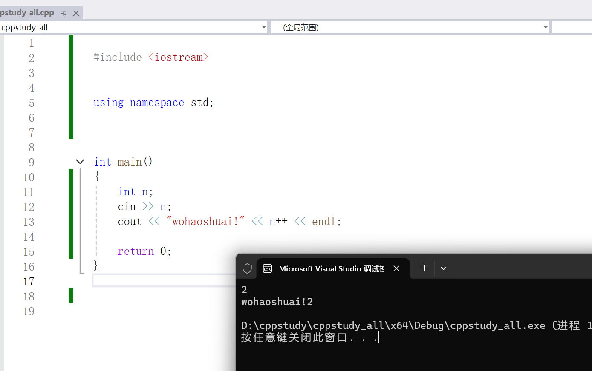

为什么要用namespace：

不同的类里面有相同的方法(函数),名字相同了。所以 使用namespace可以不用写是谁的类的方法。

例如：
student类下有add()方法
teacher类下也有add()方法

所以 可以用`using namespace 类名` 来做隔离，当然也可以用`类名::方法名` 来指定。


简单例子：
```cpp

#include <iostream>
using namespace std;

int main()
{
    int n;
    cin >> n;
    cout << "wohaoshuai!" << n++ << endl;

    return 0;
}

```


