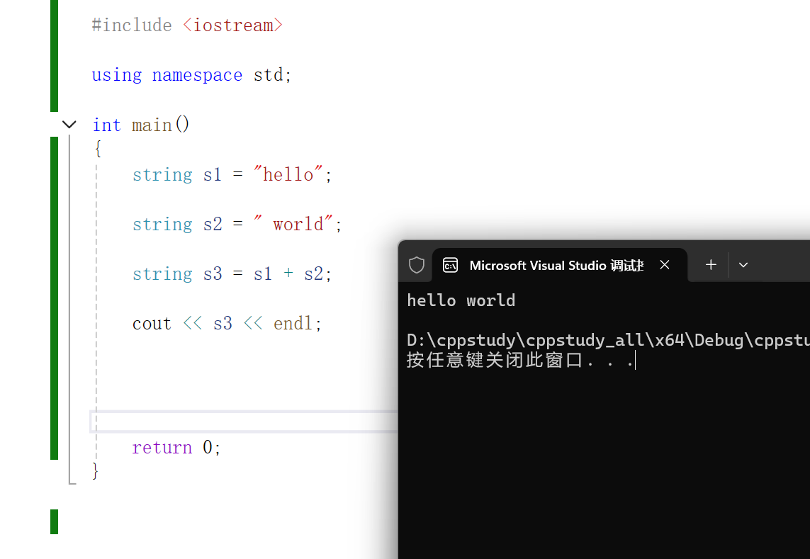

## 定义

直接当作一个数据类型来定义：
string 变量名  =  内容

它的本质上是一个类

```cpp


#include <iostream>

using namespace std;

int main()
{
    string s1 = "hello";

    string s2 = " world";


    return 0;
}


```


## 拼接
直接使用 + 即可 ，同python

```cpp


#include <iostream>

using namespace std;

int main()
{
    string s1 = "hello";

    string s2 = " world";

    string s3 = s1 + s2;

    cout << s3 << endl;

    return 0;
}


```




## 输入输出
1.`cin >> s;`

2.`cout << s << endl`

3.`getline(cin,s)` 这个方法主要解决cin只能输入一个单词的意思(字符串中的空格会被当作隔断符)


## 处理
1.获取长度：
s.length() 方法

2.截取
s.substr(m,n)：
m表示要从第几位下标开始取
n表示要往后取几位

s.substr(n):
n表示要从第几位下标开始取并且把后面的所有都取掉
