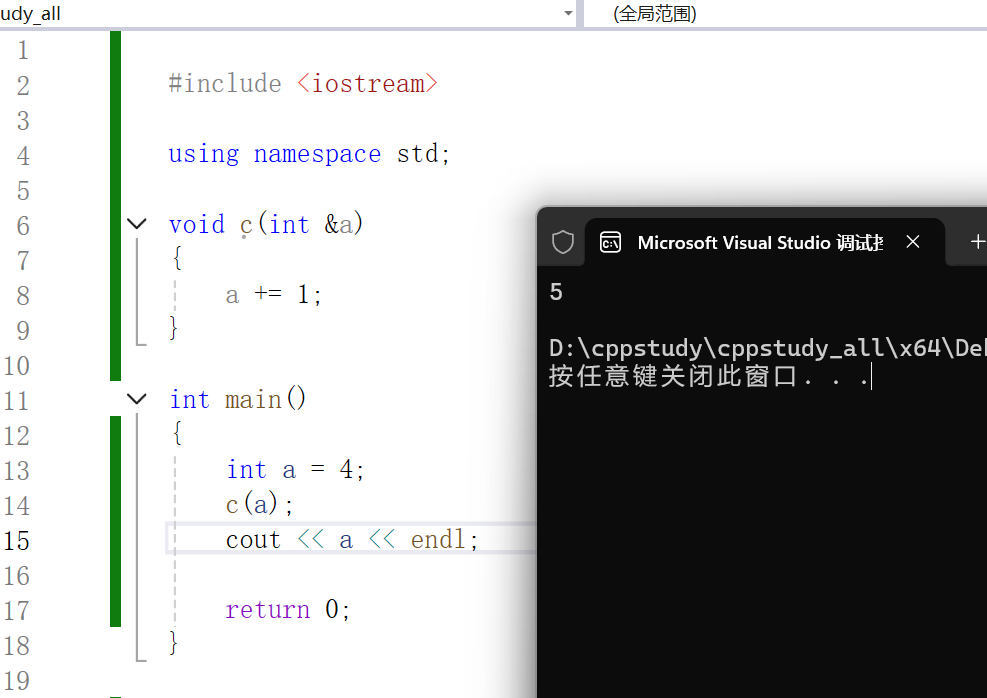

例子：

```cpp


#include <iostream>

using namespace std;

void c(int &a)
{
    a += 1;
}

int main()
{
    int a = 4;
    c(a);
    cout << a << endl;

    return 0;
}


```




这里可以理解为直接传入指针去了，不过 相对于c语言好像不需要取地址，更形象方便了。