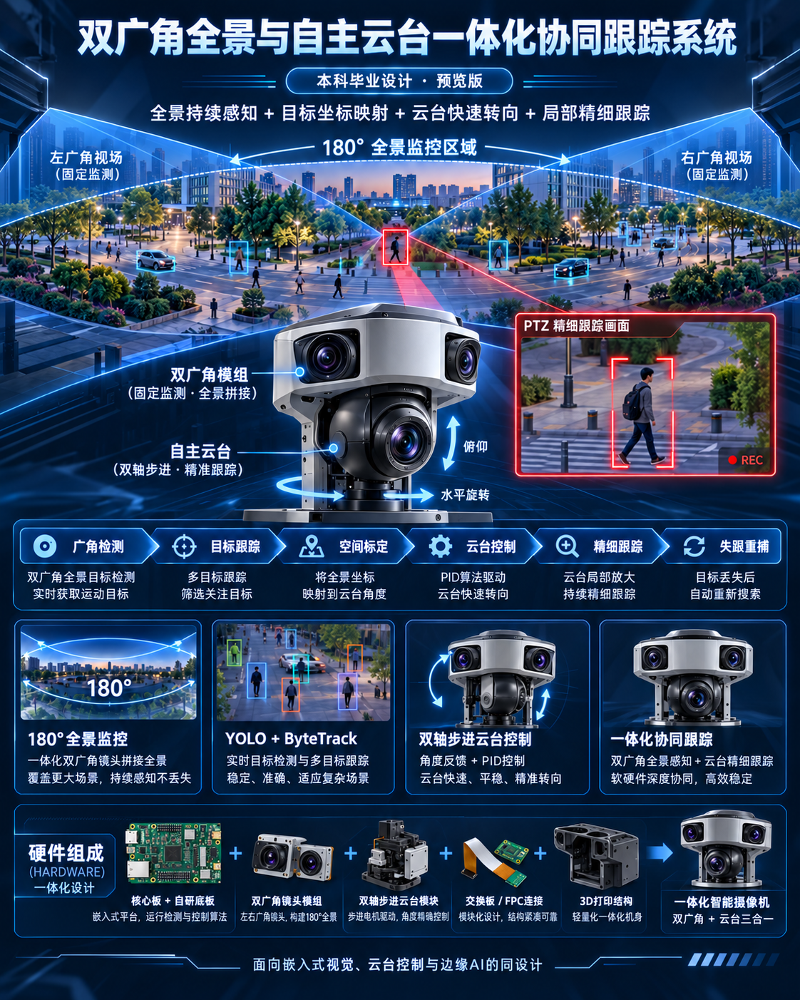

# 双广角全景与自主云台协同目标跟踪系统

> **本科毕业设计技术笔记 · 持续迭代版** 版本：`v0.2（方案设计阶段）` 
> 更新日期：`2026-10-12` 
> 状态：`总体方向明确；器件型号、机芯接口及 PCB 引脚分配待验证` 
> 定位：**以嵌入式平台为核心、自主设计硬件载板和双轴云台，构建“180° 全景搜索 + 云台特写跟踪”的视觉协同系统。**

---

## 0. 一页摘要

**核心思路：** 使用两路固定广角摄像机机芯，提供约 180° 水平全景监控；使用一套独立的可转动摄像机机芯，由自制双轴步进电机云台承载，实现目标快速指向与连续细跟踪。主控采用 **RK3588 系列核心板作为当前优先方案**，但毕设题目、总体架构和软件模块均不与 RK3588 强绑定，以便后续替换主控。

**硬件自主设计：** 自绘主控载板（集成 STM32 云台控制单元）、选购可通过软排线连接的以太网交换板、使用摄像机机芯而非完整 IPC、设计并 3D 打印双轴云台和整体外壳。硬件路线从“拼接三台成品摄像头”升级为 **自主集成的嵌入式视觉设备**。

**软件复用与新增：** 复用已有的 YOLO 检测、ByteTrack 跟踪、PID 控制、视频取流和嵌入式 Linux 经验；将新增工作集中在双广角空间统一、跨视场目标关联、全景到云台坐标标定、STM32 云台运动控制、丢失目标重捕和软硬件联调。

**最重要的工程原则：** 先验证**机芯实际输出接口 + 核心板可用接口 + 交换板软排线定义**，再画正式 PCB；先用开发验证平台跑通电机与视频，最后做一体化结构。

---

## 1. 毕设名称与边界

### 1.1 备选题目（均不锁定芯片）

1. **《基于双广角全景视觉的嵌入式云台协同跟踪系统设计与实现》**（首选：涵盖视觉、嵌入式和自主云台）
    
2. 《面向全景监控的双视场协同目标跟踪系统设计与实现》
    
3. 《基于多摄像头协同感知的智能云台目标跟踪系统设计与实现》
    
4. 《全景视觉引导下的智能云台自动跟踪系统设计与实现》
    

建议正式开题时使用第 1 个题目。芯片型号、具体镜头与电机方案放在“系统实现”章节，不写死在题目里。

### 1.2 项目与普通 YOLO 云台跟踪的差别

| 普通单镜头 PTZ 跟踪     | 本项目：双广角全景 + 独立云台机芯                 |
| ---------------- | ---------------------------------- |
| 仅看到 PTZ 当前指向的区域  | 两个固定广角机芯持续感知大范围场景                  |
| 目标可能在云台转动过程中离开视野 | 全景侧可持续提供目标轨迹和重新定位信息                |
| 发现目标、跟踪目标共用同一视野  | **广域搜索与局部精细跟踪分工**                  |
| 通常直接控制成品云台       | **自绘 STM32 控制电路 + 步进电机云台 + 3D 结构** |
| 主要工作在检测与控制       | 新增空间标定、目标关联、跨处理器通信和硬件集成            |

### 1.3 明确不做的事

- “双广角”**不是立体双目测距**：主要目的是横向视野覆盖和跨摄像头跟踪，并不默认提供目标的精确距离。
    
- 不要求从零训练新的目标检测大模型；YOLO 可直接复用、轻量化或再训练。
    
- 不把复杂的无缝视频拼接作为整个系统的唯一核心。**全景显示**与**AI 感知**可以使用不同的视频处理链路。
    
- 第一阶段不要求全向无限旋转；双轴云台可采用有限角度旋转，以避免滑环、缠线等机械风险。
    
- 不强制自研摄像机 ISP 或视频编码电路；优先使用自带成像、编码或可被主控稳定采集的成熟机芯。
    

---

## 2. 总体架构

### 2.1 系统结构图

> 以下以**三路机芯均为以太网 IP 机芯**作为首选架构。如果选到的是 MIPI CSI / USB 机芯，需要更改数据路径，详见第 4 章。**不能将 MIPI 视频直接接到以太网交换机。**

### 2.2 处理器职责分工

|单元|主要职责|不建议承担的工作|
|---|---|---|
|主控核心板（初选 RK3588）|视频采集/解码、YOLO、ByteTrack、全景坐标融合、PTZ 引导决策、上位机/Web|直接输出复杂实时电机脉冲并处理高速限位中断|
|STM32（集成在载板上）|双轴步进电机轨迹、加减速、回零、限位、位置维护、底层安全保护、与主控通信|视频解码、目标检测与全景拼接|
|交换板|三路 IP 机芯网络互联并上联主控|MIPI CSI 视频汇聚、图像拼接|
|步进驱动器|电机线圈电流控制、细分、驱动保护|高层目标识别和任务状态管理|

### 2.3 核心数据流

**原则：广角负责“知道目标在哪里”，特写负责“把目标看清并跟住”。**

---

## 3. 自主硬件设计方案

### 3.1 核心板 + 自绘载板（主要硬件工作量）

**既定方案：**采购成熟的 RK3588 / RK3588S 核心板（SOM），**自主绘制底板/载板（Carrier Board）**。核心板负责高密度 SoC、DDR、电源等复杂部分，载板负责供电、接口、STM32 和系统集成。

载板预计包含：

- 核心板连接器与必要的高速/低速接口引出。
    
- 输入电源、保险与反接/浪涌保护、各路 DC-DC 电源转换和电源时序（具体以核心板要求为准）。
    
- 核心板与交换板上联接口（优先确认核心板的 Ethernet PHY/MAC 与连接器定义）。
    
- 板载 STM32 单片机及其下载、复位、Boot、调试与通信接口。
    
- 双轴电机驱动控制信号、原点/限位传感器输入、急停/故障输入。
    
- 摄像机机芯供电接口、可变焦/调焦控制接口（取决于采购机芯）。
    
- 适当的 USB、调试串口、状态 LED、风扇 PWM、温度检测预留。
    
- 排线固定孔、结构安装孔、接地设计以及散热空间。
    

**关键限制：**不要在核心板具体型号未定时，提前锁定载板接口位置与 Pinout。不同 RK3588 系列核心板的接口、电压、PHY、复位、上电要求可能完全不同。

### 3.2 交换机芯片板 + 软排线

用户计划采购**可通过 FPC/FFC 软排线接入的紧凑交换板**，减少 RJ45、水晶头和网线在设备内部占用的空间。这一方向合理，但要明确：

**“摄像机机芯具有网口”不等于“机芯的任何排线都能接以太网交换芯片”。**

购买前逐项核对：

|要验证的项目|为什么重要|验证结果|
|---|---|---|
|机芯端究竟是 Ethernet、RMII/MII、MIPI CSI、USB 还是其它|决定能否接交换板|待确认|
|Ethernet PHY 和网络变压器分别位于哪块板上|直接影响 FPC 连接方式、隔离与电气可靠性|待确认|
|交换板的 FPC 脚位表、引脚间距、电压、GND 分配|避免排线方向接反、接口不兼容|待确认|
|交换板支持端口数|需要至少满足**3 个 IP 机芯 + 1 个主控上联**|待确认|
|主控上联采用何种网络接口与速率|三路视频需经上联链路汇聚|待确认|
|FPC 的差分信号设计、线长、屏蔽及 EMC 约束|高速信号不能按普通低速 GPIO 处理|待确认|
|每路机芯的实际供电、电流与最大功耗|交换板不必然承担摄像机供电|待确认|

**选型建议：**尽量购买明确给出硬件原理图、Pinout 和机械尺寸的交换板；最好与机芯供应商确认“无 RJ45 的板间连接”方案。Ethernet PHY、网络变压器和 FPC 的物理边界应按真实参考设计确定，不能为了缩小体积擅自省略必要电路。

> **工程门槛 G1：**至少用一台目标机芯，经候选交换板及目标 FPC 连接方式稳定输出 RTSP，再确认交换板的选型。

### 3.3 采购摄像机机芯，而不是完整 IPC

计划采购三路**裸机芯/模组**：

|通道|作用|建议关注项|
|---|---|---|
|左侧广角|全局感知左半场|实测**水平**视场角、畸变、低照度、固定曝光支持、同步/时间戳|
|右侧广角|全局感知右半场|尽量与左侧同型号、同焦距、同固件、同成像规格|
|独立特写|云台精细跟踪|成像质量、视场角、外部控制接口、体积质量、低延时，变倍能力按需选配|

**采购优先级：**稳定的视频输出和可获取的接口文档 ＞ 体积缩小 ＞ 极高分辨率 ＞ 宣传的 AI 功能。

机芯可选的两种技术路线：

|路线|视频连接|优点|难点|对本项目的建议|
|---|---|---|---|---|
|**A：IP 网络机芯（机芯自带 ISP / 编码 / 网络能力）**|Ethernet → 交换板 → 主控|最接近已有 RTSP/RKMPP 软件链路，多路扩展清晰|接口与 PHY/磁性器件、FPC、电源、视频时延需要核对|**当前首选**|
|B：MIPI CSI 裸模组|MIPI CSI → 主控对应接口|体积小、链路可控|驱动、设备树、ISP、排线长度、CSI 路数、同步均可能较复杂|仅在具备完整驱动和接口条件时采用|

二者不能按同一交换板架构混接。**先选“机芯类别与接口”，再决定载板和交换板。**

**关于第三路特写机芯：**

- 第一版可使用定焦/小视场角机芯验证云台定位与追踪。
    
- 若最终论文需要“长焦特写/自动变倍”，再采购带有可控光学变倍机构和清晰串口/协议文档的变焦机芯。
    
- 变焦机芯的镜头电机控制协议不一定与视频输出协议相同，必须单独核对。
    
- 三路机芯全部采用网络接口是首选假设，不代表已确认有满足体积和预算的具体型号。
    

### 3.4 双轴步进电机云台（自研结构与控制）

云台不直接采购整套 PTZ；由两个步进电机驱动**水平（Pan）+ 俯仰（Tilt）**机构，搭载第三路特写机芯。

**建议组成：**

- 水平轴：步进电机 + 必要的减速/传动结构 + 原点与机械限位。
    
- 俯仰轴：步进电机 + 支承轴承 + 平衡结构 + 原点/限位。
    
- 步进驱动：成熟驱动芯片/模块（例如 TMC 系列或同级别方案，最终按电机电流和电压选型）。
    
- 机械件：SolidWorks（或等效 CAD）建模、3D 打印机架和外壳，关键受力件可配合金属轴、轴承和标准紧固件。
    
- 连接：控制信号从 STM32 到驱动器；电机动力线单独布线，尽量远离摄像机信号线。
    

**结构设计需要实际计算：**

1. 特写机芯、外壳和线束的**总质量与重心**。
    
2. 俯仰轴相对重心的偏移，所需静态保持力矩和加速力矩。
    
3. 电机的保持力矩、加速余量、减速比与最高转速。
    
4. 传动间隙、回差、轴承刚度以及 3D 打印件的弯曲变形。
    
5. 线束随轴转动的弯折半径、磨损、限位和是否需要滑环。
    
6. 运行噪声、发热及是否需要机械制动或防坠落措施。
    

**第一版建议：**有限角度旋转 + 原点开关 + 软件软限位，避免一开始就追求 360° 连续旋转。工作范围根据全景覆盖与机芯安装位置确定，不提前写死。

### 3.5 板载 STM32 控制单元

STM32 放在主控载板上，承担底层实时执行，便于硬件一体化。初期可沿用熟悉的 STM32F1/F4 设计思路，但芯片选型以**定时器、UART、GPIO、Flash、成本和开发便利性**为依据。

建议采用的控制链路：

 主控 Linux（高层目标位置 / 角度指令）  
        │ UART（板内短距可优先；具体电平按硬件确认）  
        ▼  
 STM32（状态机 + 回零 + 运动轨迹规划）  
        │ STEP / DIR / EN  
        ▼  
 双轴步进电机驱动器  
        │  
        ▼  
 水平轴 / 俯仰轴  
        ▲  
        │ 原点、限位、故障信息（编码器可选）  
        └──────── STM32

主控与 STM32 通信可先定义固定帧的二进制协议：

|命令|字段建议|作用|
|---|---|---|
|`HOME`|轴标识、超时参数|回零并重建坐标参考|
|`MOVE_ABS`|Pan/Tilt 目标位置、最大速度/加速度|快速指向|
|`MOVE_VEL`|Pan/Tilt 期望速度|细跟踪控制|
|`STOP`|停止方式|平稳停机或紧急停止|
|`GET_STATE`|时间戳、当前位置、运动状态、故障位|状态反馈|
|`SET_LIMIT`|软件行程、速度限制|安全配置|

实际协议需要帧头、长度、版本号、序号、CRC、应答与超时机制。**涉及电机驱动的指令必须定义“通信丢失后如何停机”**。

> **控制精度提醒：**“步进电机发了多少脉冲”不等于“云台实际转过了多少角度”。开环步进系统可能丢步，细分也不等于机械绝对定位精度。最少应具备可靠的回零与限位；若定位误差不稳定，再考虑输出轴编码器闭环。

### 3.6 电源和散热设计

- 电源拓扑需按核心板、机芯和电机驱动的实际电压、峰值电流定稿。不要先随意决定所有模块都用 12V。
    
- 电机供电与敏感数字/相机信号供电分区；设置足够的储能电容、滤波与保护。
    
- 调试阶段至少记录：待机、运动、加速瞬间、三路满负荷取流推理时的供电波动。
    
- 核心板必须规划散热器/风道；摄像机机芯、交换板、DC-DC 也可能产生局部热点。
    
- STM32 的急停和限位安全策略应独立于 Linux 进程是否正常运行。
    
- 自绘载板如集成步进功率级，要重点考虑铜箔电流、驱动器热阻及与视频高速接口之间的干扰。
    

---

## 4. 视觉、空间映射与控制算法

### 4.1 左右广角有效覆盖约 180°

两只广角机芯存在重叠区，用于完成图像映射和目标跨镜头关联。

若左右镜头**实测水平视场角**分别为 \phi_L、\phi_R，重叠角为 \phi_O，理想几何覆盖近似：

$$  
\phi_{\mathrm{union}} \approx \phi_L + \phi_R - \phi_O  
$$

  

例如两侧均为 110^\circ、重叠 30^\circ，则理论联合水平覆盖约 190^\circ；最终通过安装角度与有效区域裁剪得到接近或不少于 180^\circ 的可用视野。**镜头宣传的对角 FOV 不能当作水平 FOV。**

需明确：“180°”指的是_水平方位覆盖_，并非目标在任何距离/高度下都可无死角被捕捉。

### 4.2 全景展示与 AI 跟踪分离

推荐采用两条并行处理链：

 A. 视觉展示：左右相机 → 去畸变 → 统一投影 → 重叠区融合 → Web 全景画面  
 B. AI 跟踪：左右原始帧 → 各自 YOLO + ByteTrack → 坐标归一 / 跨镜头关联 → 全局目标表

理由：

- 将 YOLO 直接运行在强烈拉伸的拼接图上，可能降低检测质量。
    
- 两路视频编码与采集不同步时，重叠区的移动目标容易出现重影。
    
- 固定镜头可提前计算畸变和投影查找表，减少运行时开销。
    
- **更重要的是准确、稳定地获得目标角位置，而不是追求毫无拼缝的画面。**
    

### 4.3 YOLO + ByteTrack 与全局目标 ID

- 左右各自运行目标检测和 ByteTrack，产出局部 ID、边界框、置信度、时间戳。
    
- 通过摄像机标定将目标位置映射到统一全景方位坐标。
    
- 在重叠区利用**空间一致性 + 时间窗口 + 运动连续性**关联左右局部轨迹。
    
- 给同一物理目标分配全局目标 ID，并维持目标状态（可见、遮挡、丢失、切换）。
    
- 多人交错严重时，再考虑外观特征 ReID；不要在第一版就增加过多模型。
    

### 4.4 全景坐标映射到云台角度（核心论文内容）

理想化情况下，对均匀方位角投影的水平 180° 全景图，图像横向位置 u 与方位角 \alpha 的近似关系是：

$$  
\alpha \approx \frac{u}{W} \times 180^\circ - 90^\circ  
$$

  

其中 W 为全景图的宽度。**该公式只是在特定投影条件下得到的全景方位角，不能直接当作云台电机角度。**

实际系统需要考虑：

1. 广角机芯内参、畸变和两路相机的外参。
    
2. 全景摄像机与云台转动中心之间的位置偏差。
    
3. PTZ 机芯相对云台两轴的机械安装误差。
    
4. 被跟踪目标的距离、高度和近距离视差。
    
5. 步进电机回零偏差、机械传动回差和可能的失步。
    

**推荐采用“两级控制”：**

- **一级：广角引导的粗定位。**多点标定建立全景目标位置与云台目标角度的映射；STM32 执行带限速/加减速的快速转向。
    
- **二级：特写摄像机的视觉闭环。**进入目标附近后，特写机芯重新检测目标，计算画面中心误差，由 PID 或分层控制策略完成精细对中。
    

标定优先实现：手动采样多点 → 建立映射表/插值模型 → 留出测试点计算误差。之后再尝试半自动标定与按目标距离分区优化。

### 4.5 PTZ 双轴 PID / 跟踪控制

现有 PID 经验可复用，但这里需要明确区分：

- **电机底层：**STM32 负责速度/位置轨迹执行，步进驱动器完成微步电流控制。
    
- **视觉外环：**Linux 端计算特写目标相对画面中心的误差，按一定频率输出期望角速度或修正目标角度。
    

视觉误差可以归一化定义：

$$  
e_x = \frac{u_t-u_c}{W/2}, \qquad e_y = \frac{v_t-v_c}{H/2}  
$$

  

其中 (u_t,v_t) 为目标中心，(u_c,v_c) 为图像中心。需要结合镜头 FOV、当前变焦倍率、控制周期和运动方向进行增益整定。

建议加入：死区、积分限幅、最大速度限制、加速度限制、命令有效期，以及**粗定位阶段与细跟踪阶段互斥**的控制权机制。

### 4.6 协同控制状态机

必须保证故障状态下 STM32 可以安全停机，不依赖 Linux 的视频服务仍在运行。

---

## 5. 软件工程组织

### 5.1 建议模块

|子模块|工作内容|复用程度|
|---|---|---|
|视频接入|三路视频取流、解码、时间戳和缓存管理|较高（如 RTSP/RKMPP）|
|AI 推理|YOLO NPU 部署、推理调度|较高|
|单路跟踪|ByteTrack、目标筛选|较高|
|全景坐标|左右去畸变、投影、标定与展示|新增|
|全局目标关联|重叠区 ID 关联、轨迹管理|新增|
|空间标定|全景像素/角度 → 云台位置|**核心新增**|
|云台控制|串口协议、双轴粗定位、视觉 PID|部分复用，硬件执行层新增|
|STM32 固件|步进驱动、回零、限位、安全与反馈|新增|
|Web UI|目标选择、左右/全景/特写视频、参数和日志|部分复用|
|实验与评估|延迟、精度、失跟重捕及设备功耗|新增|

### 5.2 推荐仓库目录

 panoramic-ptz-tracking/  
 ├── README.md  
 ├── docs/  
 │   ├── requirements.md          # 需求与验收  
 │   ├── architecture.md          # 软硬件架构  
 │   ├── decisions.md             # 选型记录 / 决策日志  
 │   ├── calibration.md           # 全景及云台标定  
 │   ├── protocol.md              # Linux ↔ STM32 通信协议  
 │   ├── test-plan.md             # 实验方案与测试数据定义  
 │   └── bill-of-materials.md     # BOM 与采购记录  
 ├── hardware/  
 │   ├── carrier-board/          # 自绘主控载板工程  
 │   ├── mechanical/             # 云台、支架、3D 模型  
 │   └── datasheets/             # 授权保存的数据手册  
 ├── firmware/  
 │   └── stm32-pan-tilt/         # STM32 运动控制固件  
 ├── software/  
 │   ├── camera-input/  
 │   ├── detection-tracking/  
 │   ├── panorama-mapping/  
 │   ├── target-association/  
 │   ├── calibration/  
 │   ├── ptz-control/  
 │   └── web-ui/  
 ├── tests/  
 │   ├── camera/  
 │   ├── motor/  
 │   ├── calibration/  
 │   └── experiments/  
 └── assets/  
     ├── figures/  
     └── demo/

### 5.3 性能实现原则

- 三路视频尽可能使用硬件解码，避免无意义的软件拷贝。
    
- 只向 AI 检测链路提供**最新可用帧**，不要让旧帧无限堆积。
    
- 广角视觉检测频率、特写检测频率与 Web 显示帧率不必相同。
    
- 给每个关键处理结果附时间戳和对应摄像机 ID。
    
- 控制端使用目标预测或补偿时，先明确目标轨迹时间戳与图像采集延迟。
    
- 在模型输入分辨率、目标速度、云台转速与目标距离之间寻找实际可行的平衡，而非仅追求 NPU TOPS 数字。
    

---

## 6. 验证顺序：避免“PCB 画完才发现连不上”

这是整个项目最关键的实施策略。由于本次新增了自绘载板、交换板、摄像机机芯和自研步进云台，**硬件风险比直接购置成品 PTZ 高得多**。建议按下列关口执行：

|关口|必须先证明的事实|通过后才允许做什么|
|---|---|---|
|**G0：机芯接口确认**|两广角 + 特写机芯的接口、电压、尺寸、SDK/协议清晰|冻结摄像机类别|
|**G1：交换板验证**|实际机芯经 FPC/候选交换板与主控稳定传输；上联带宽足够|确定交换板与连线|
|**G2：步进云台样机**|STM32 + 驱动器 + 两轴电机可以回零、限位、位置/速度控制|冻结云台电机参数|
|**G3：视觉粗定位闭环**|全景目标可以转换为云台角度，并使特写机芯看到目标|确定空间标定方案|
|**G4：载板 REV.A**|核心板供电、STM32、UART、网络、相机电源、电机信号稳定|做正式整机装配|
|**G5：完整闭环**|目标选择→快速转向→特写跟踪→丢失重捕|进入对比实验与论文|

### 6.1 推荐的样机演化路线

**样机 V0｜纯功能验证（尽量不画大板）**

- 主控用现有 RK3588 系列开发板或其他可用 Linux 边缘计算板。
    
- 两路广角机芯和一路特写机芯，先把视频链路跑通。
    
- STM32 小板 + 现成步进驱动模块 + 简易 3D 打印云台。
    
- 完成最小闭环：全景点选目标 → 云台转向 → 特写检测与跟踪。
    

**样机 V1｜硬件集成验证**

- 正式绘制主控载板，集成 STM32、供电与接口。
    
- 用交换板和 FPC 替代设备内部的体积庞大的网络连接。
    
- 完成云台结构与整机内部布置，验证通信干扰和散热。
    

**样机 V2｜完整毕设展示**

- 稳定的全景感知 + PTZ 细跟踪 + 目标失跟重捕。
    
- 完整外壳、可视化界面、可靠的线束布置。
    
- 实测数据、测试报告、论文及演示视频。
    

> **必要的退路：**即使交换板或自绘载板需要二次改板，软件也应能在 V0 开发平台上独立运行。不要让一次 PCB 失误导致整个毕设无法展示。

---

## 7. 论文重点、创新点与实验指标

### 7.1 建议聚焦的三项研究内容

1. **基于双广角视觉的全景目标空间定位及云台映射方法。** 研究镜头标定、统一方位坐标、目标坐标到云台角度的变换以及误差补偿。
    
2. **面向全景—特写双视场的目标连续跟踪与重捕策略。** 利用全景轨迹保持全局目标身份，并在特写画面丢失时快速重新指向。
    
3. **自主步进云台与嵌入式视觉算法的协同控制系统。** 实现 Linux+STM32 分层控制、运动规划、视觉闭环和软硬件实时性优化。
    

说明：这三项是**拟形成的技术贡献**，不预先宣称它们是新的基础算法；论文创新性仍需结合文献检索与实验对比确认。

### 7.2 实验设计

|实验|对照方式|指标|
|---|---|---|
|双广角覆盖|理论视场 vs. 实测视场|有效覆盖角、重叠范围、盲区位置|
|空间标定|简单线性映射 vs. 多点标定/插值|平均/最大转向角误差、初次捕获成功率|
|双轴运动控制|直接阶跃 vs. 加减速控制；是否加入反馈/补偿|到位时间、过冲、重复定位偏差|
|协同重捕|PTZ 自主搜索 vs. 全景引导重捕|重捕时间、成功率|
|跨广角关联|左右独立跟踪 vs. 全局 ID 管理|ID 切换次数、目标连续率|
|实时性|不同分辨率/模型/调度方式|FPS、端到端时延、处理器负载|
|工程可靠性|长时间运行、极端角度/反复回零|失步、串口错误、异常停机、温升|

**实验注意事项：**

- 使用固定的目标运动路线、相近光照、距离和云台初始位置，避免对照不公平。
    
- 对不同距离分别做空间标定误差测试，因为安装基线会引入近距离视差。
    
- 至少在静止目标、单目标运动、多人交错和左右重叠区切换场景进行评估。
    
- 预先定义“捕获成功”“丢失”“重捕成功”的判定标准。
    
- 关键实验建议多次重复，保留视频、时间戳和原始日志，不只展示一个成功演示。
    

### 7.3 论文可能的章节结构

1. 绪论：背景、全景与 PTZ 联动技术现状、研究内容。
    
2. 系统总体设计：需求、结构、硬件接口、软件分层。
    
3. 系统硬件设计：核心板载板、STM32、交换板接入、步进云台、3D 结构与电源。
    
4. 全景目标感知与空间标定：双广角成像、坐标映射、目标关联、标定模型。
    
5. 云台协同控制：通信协议、回零/运动规划、粗定位、PID 精细跟踪、重捕状态机。
    
6. 系统实现与实验：软硬件集成、性能测试、对照实验、误差分析。
    
7. 总结与展望。
    

---

## 8. 风险清单与应对策略

|风险|级别|具体表现|应对|
|---|---|---|---|
|**机芯输出接口与交换板不兼容**|高|机芯为 MIPI/RMII，交换板仅支持 Ethernet PHY 接入|G0/G1 先验证真实接口，不先画 PCB|
|核心板载板高速接口不匹配|高|Pinout、电平、PHY/磁性器件不符合要求|严格按核心板硬件手册及参考设计|
|两广角难以实现良好拼接|中|视差、不同步、重影、曝光不一致|检测在原始图上进行；拼接只承担展示|
|空间映射对距离敏感|高|近距离或高处目标初次指向偏离|实验界定有效距离；粗定位 + 特写细校准|
|云台丢步/机械回差|高|偏差累计、重新跟踪不准|回零、限位、加减速、结构刚度；必要时编码器|
|电机驱动噪声干扰摄像机|中高|丢包、串口异常、视频花屏|分区布线、滤波、地回流和电源隔离策略|
|载板迭代耗时|高|错误引脚、贴装和返修|先 V0 验证，REV.A 优先保证最小功能|
|3D 打印结构刚性不足|中|抖动、振动、定位误差|关键部位加轴承/金属件、迭代验证|
|任务过大|高|硬件、算法、结构三线推进导致延期|把“闭环跟踪演示”放在全景美化之前|

---

## 9. 开发时间表（按约 16 周规划，可按学校实际期限压缩）

|时间|主要任务|阶段成果|
|---|---|---|
|第 1–2 周|机芯、核心板、交换板资料核对；确定接口和 BOM 草案|G0：接口方案确定|
|第 3–4 周|三路取流验证；步进云台搭建与 STM32 固件原型|G1/G2：视频与两轴运动可运行|
|第 5–6 周|双广角相机标定、全景统一坐标与目标跟踪|全局目标位置可获取|
|第 7–8 周|全景→云台标定、粗定位与特写闭环|G3：最小协同跟踪演示|
|第 9–10 周|载板原理图、PCB、STM32 电路、结构件优化|REV.A 投板/制造|
|第 11–12 周|载板焊接调试、FPC 与电机布线、整机集成|G4：主控载板联调|
|第 13–14 周|目标失跟重捕、控制整定、视频与运动时延优化|G5：完整演示版本|
|第 15–16 周|多场景对比实验、论文、答辩演示|实验数据和成果文件|

**时间安排说明：**硬件机芯、交换板、PCB 加工和 3D 结构都存在采购/返工周期；建议并行准备，但不要让彼此尚未验证的接口形成依赖。若只剩 12 周，应把“正式载板与整机外观”的复杂度降级，优先保住已实现的 V0 软硬件闭环。

---

## 10. 初步 BOM / 采购记录模板

> **以下均未锁定品牌和具体型号。**成本在取得真实报价、机芯规格和加工方案后填写，不能套用成品 IPC/PTZ 方案的旧预算。

|类别|部件|数量|型号|关键接口/参数|预算|状态|
|---|---|---|---|---|---|---|
|主控|可更换核心板（当前优先 RK3588 系列）|1|待定|Pinout、电源、接口、Linux BSP|待定|待选|
|主控|自绘载板 PCB/贴片|1–2 版|自研|核心板插座、STM32、供电、扩展接口|待定|待设计|
|网络|小型交换机芯片板|1|待定|≥4 连接端口，FPC/FFC 引脚定义|待定|待选|
|视频|左广角 IP 机芯|1|待定|水平 FOV、编码、Ethernet、供电|待定|待选|
|视频|右广角 IP 机芯|1|待定|尽量与左机芯一致|待定|待选|
|视频|特写/可变焦机芯|1|待定|视频接口、镜头 FOV、变焦控制|待定|待选|
|控制|STM32 与外围元器件|1 套|待定|UART、定时器、限位 IO|待定|待选|
|控制|步进电机驱动器|2|待定|供电、电流、细分、STEP/DIR|待定|待选|
|机械|两轴步进电机|2|待定|力矩、转速、尺寸、温升|待定|待选|
|机械|原点/限位传感器|≥2|待定|冗余与位置视机构而定|待定|待选|
|机械|轴承、紧固件、传动件|1 套|待定|精度与刚性|待定|待选|
|机械|3D 打印云台、支架与外壳|1 套|自研|精度、材料、耐温、强度|待定|待设计|
|连接|FPC/FFC 与连接器|若干|待定|Pinout、差分信号、电流、耐弯折|待定|待选|
|电源|电源模块、DC-DC、保护|1 套|待定|由各模块实测功耗确定|待定|待选|

---

## 11. 开题前必须确认的技术决策（持续维护）

|编号|待决定事项|现阶段倾向|定案条件|
|---|---|---|---|
|D01|正式论文题目|不出现 RK3588 型号|学校/导师审题通过|
|D02|核心板平台|RK3588 系列 SOM|有供货、开发 BSP、接口资料且预算允许|
|D03|三路机芯数据接口|优先 IP 网络机芯|G0/G1 证明 Ethernet/FPC 连接可行|
|D04|交换板|现成紧凑型交换板 + FPC|接口定义和实际稳定传输验证|
|D05|第三路是否采用光学变倍|可以后加|有可控协议、重量/体积/预算可接受|
|D06|STM32 型号|复用熟悉系列|定时器与 IO 满足，供货稳定|
|D07|电机与传动|双轴步进 + 限位|计算力矩、做台架样机后决定|
|D08|运动反馈|首版开环 + 回零|重复定位误差测试后考虑编码器|
|D09|图像拼接策略|展示链拼接；AI 链原始帧|原型验证检测质量和时延|
|D10|空间标定策略|多点映射 + PTZ 视觉细校|不同角度和距离的实测误差|
|D11|整机供电电压|暂不锁定|电机、机芯、SOM 电源规格明确|
|D12|Linux ↔ STM32 通信|板内 UART 优先|调试及电磁兼容测试通过|

---

## 12. 近期行动清单

### 第一优先级：硬件接口选型

- [ ]  选出 2–3 款可采购的**广角 IP 机芯**，拿到引脚表、水平 FOV、供电和视频协议。
- [ ]  选出 1–2 款可采购的**特写/变焦机芯**，确认具体的视频与镜头控制接口。
- [ ]  选出目标**交换机芯片板**，取得 FPC Pinout、原理图或明确的接线资料。
- [ ]  确认各路机芯的 Ethernet PHY / 网络变压器的位置，完成信号链连线图。
- [ ]  核对 RK3588 系列候选核心板的载板开发手册、原理图示例与连接器定义。
- [ ]  画一个**接口关系表**（每路信号：源端、目的端、电平、速率、电源、排线长度）。

### 第二优先级：最小可运行平台

- [ ]  在开发板上跑通多路视频取流与 YOLO 推理。
- [ ]  用独立 STM32 开发板驱动 Pan/Tilt 两轴步进电机。
- [ ]  加入回零、限位、急停和通信超时保护。
- [ ]  完成目标在广角画面出现后，PTZ 云台转向该目标的粗定位演示。

### 第三优先级：正式 PCB 与机械结构

- [ ]  计算两轴电机所需力矩和结构边界。
- [ ]  完成机芯、核心板、交换板和运动机构的 3D 布局。
- [ ]  确认外壳内部 FPC 走线弯折半径、散热、安装和维修空间。
- [ ]  绘制主控载板 REV.A 原理图和 PCB，并进行电气规则与设计规则检查。
- [ ]  留出串口、SWD、关键电源测试点、网络连接调试能力，便于返修。

---

## 13. 重要的工程/学术说明

1. **不是凭空发明全景 + PTZ 联动。** 商业产品已有类似工作模式；本毕设重在嵌入式自主集成、空间标定与协同控制的可复现实验。
    
2. **自绘 PCB 也是正式工程工作量。** 需要保存原理图、PCB、BOM、供电计算、调试记录、改板记录，而不是只放成品照片。
    
3. **3D 打印不是仅做外壳。** 云台传动、安装基准、重心、刚性、走线和可靠性都属于机械设计内容。
    
4. **算法指标不能空口承诺。** 角度误差、捕获成功率、失跟重捕时间、FPS 和功耗均应以测试结果为准。
    
5. **与既有企业项目区分。** 既有 YOLO/ByteTrack/PID/驱动经验是技术基础；论文需明确本人新增工作和实验数据，并核对相关代码、硬件资料和数据的使用许可。
    
6. **先通链路，再减体积。** 工程成熟度应按“功能正确 → 稳定 → 集成小型化 → 外观完善”的顺序提升。
    

---

## 14. 迭代记录

|版本|日期|主要变更|
|---|---|---|
|v0.1|前期讨论|双广角 180° + PTZ 自动跟踪，复用 YOLO/ByteTrack/PID|
|**v0.2**|**2026-10-12**|**正式转为核心板 + 自绘载板、FPC 交换板、裸机芯、STM32 自研双轴步进云台、3D 打印结构；标题不锁定 RK3588；增加接口验证门槛和硬件开发计划**|

> **下一轮适合补充：**具体机芯候选与接口照片、交换板产品资料、目标核心板的载板设计资料、两轴云台草图、功耗预算与硬件原理图模块划分。